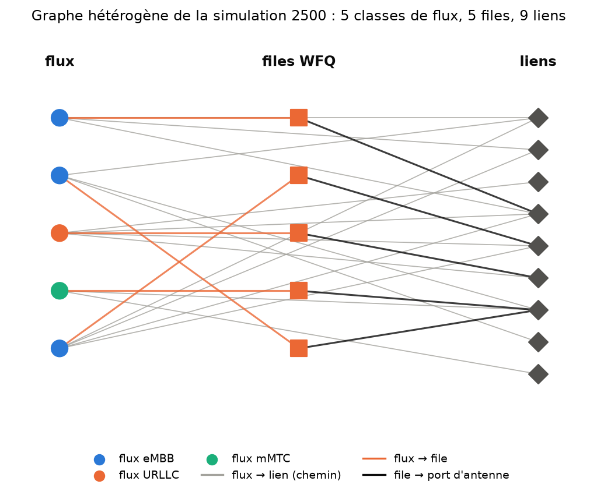
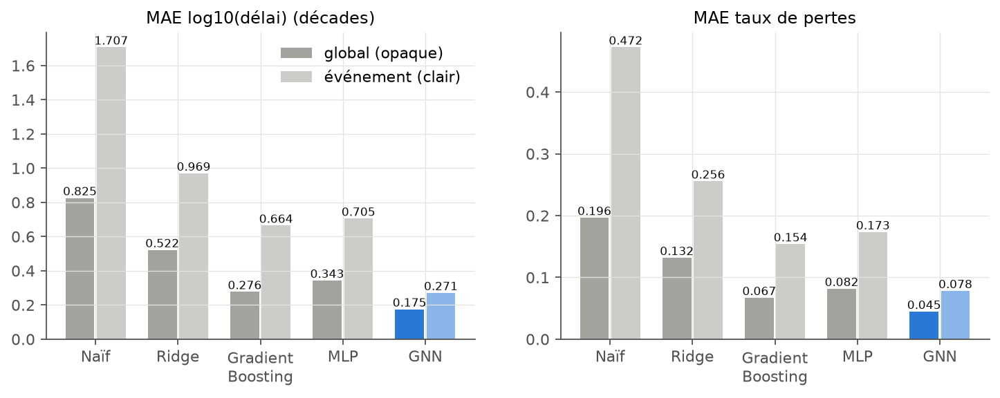

# AI-Based Dynamic Resource Allocation for B5G Network Slicing


Projet SMARTICT (INPT, filière Smart ICT) : prédire la QoS (délai, pertes) de chaque flux des slices
eMBB / URLLC / mMTC à partir de la configuration du réseau et des réservations WFQ, comparer des
modèles sans graphe à un **GNN hétérogène** (flux / files WFQ / liens), et tester leur robustesse lors
de changements brusques (surcharge, délestage).

<p align="center">
  
  
</p>

## Résultats principaux

Jeu de test (découpage par topologie, 218 628 flux) — erreur absolue moyenne, plus bas = meilleur :

| Modèle | MAE délai | MAE pertes |
|---|---:|---:|
| Naïf | 0.825 | 0.196 |
| Ridge | 0.522 | 0.132 |
| MLP | 0.343 | 0.082 |
| Gradient Boosting | 0.276 | 0.067 |
| **GNN (SliceGNN)** | **0.175** | **0.045** |

Données : 7 127 simulations, 162 topologies, 1,58 M flux (≈ 13,6 % des flux touchés par un événement).
Détails, ablations et analyse du décalage de distribution dans le [rapport](rapport/rapport_B5G_slicing_GNN.pdf)
et le [notebook](projet_B5G_slicing_GNN.ipynb).

## Livrables

| Fichier | Contenu |
|---|---|
| [`projet_B5G_slicing_GNN.ipynb`](projet_B5G_slicing_GNN.ipynb) | notebook exécuté : EDA, formulation, baselines, événements, graphe, GNN, comparaison, analyse |
| [`rapport/rapport_B5G_slicing_GNN.pdf`](rapport/rapport_B5G_slicing_GNN.pdf) | rapport final, avec un chapitre d'état de l'art (source LaTeX dans `rapport/`) |
| [`presentation/Presentation_B5G_Slicing_GNN.pptx`](presentation/Presentation_B5G_Slicing_GNN.pptx) | présentation de soutenance (30 diapositives, discours dans les notes de l'orateur) |
| [`presentation/discours_soutenance.md`](presentation/discours_soutenance.md) | discours complet minuté (≈ 23 min 30), version imprimable |
| [`Guide_du_code.pdf`](Guide_du_code.pdf) | guide du code : rôle de chaque fichier, fonctions, « où est… ? », comment modifier |
| [`figures/`](figures/) | figures produites par le notebook (utilisées par le rapport et la présentation) |
| [`results/`](results/) | modèles entraînés (`.pt`), historiques d'entraînement, métriques, tableaux LaTeX, journaux |

## Structure

```
├── code/            pipeline Python (extraction → features → modèles → évaluation)
├── data/            dataset (non versionné, voir data/README.md)
├── figures/         figures du notebook
├── presentation/    soutenance (.pptx) et scripts de génération
├── rapport/         rapport PDF + sources LaTeX
├── results/         métriques, modèles, journaux, tableaux
└── projet_B5G_slicing_GNN.ipynb
```

## Code (`code/`)

| Fichier | Rôle |
|---|---|
| `extraction.py` | archives brutes → `data/processed/{samples,flows,links,queues}.parquet` (chemins reconstruits depuis le routage) |
| `features.py` | 24 features par flux à partir des entrées uniquement ; classes de flux |
| `preparation.py` | classes de flux, masque d'événements, graphes (`graphs.pkl`) |
| `splits.py` | découpages par topologie (`topo`) et décalage vers les grands réseaux (`shift`) |
| `run_tabular.py` | naïf, Ridge, Gradient Boosting, MLP |
| `gnn.py`, `run_gnn.py` | SliceGNN (flux / files WFQ / liens) et son entraînement (CPU ou GPU) |
| `evaluation.py` | MAE / MSE pondérées par flux, global et par type d'événement |
| `run_all.sh` | pipeline complet |
| `notebook_cells.py`, `build_notebook.py` | source du notebook |
| `../presentation/build_deck.js`, `../presentation/discours.js` | génération de la présentation et texte du discours |

## Reproduire

```bash
pip install -r requirements.txt
```

1. Télécharger le dataset Zenodo [10.5281/zenodo.10610616](https://doi.org/10.5281/zenodo.10610616)
   (`slicing-simulations.zip`, 271 Mo) dans `data/raw/` et le décompresser (≈ 6,6 Go une fois extrait).
2. `bash code/run_all.sh [python_avec_pytorch_cuda]` : extraction (≈ 6 min), préparation (≈ 3 min),
   modèles tabulaires (≈ 25 min CPU) et 10 entraînements GNN (≈ 16 min chacun sur GPU, ≈ 5× plus sur CPU).
3. Exécuter le notebook (il relit les résultats en cache ; `FORCE = True` pour tout recalculer).

Les prédictions par flux (`results/*_preds.parquet`, ≈ 50 Mo) ne sont pas versionnées : elles sont
régénérées à l'étape 2.

Le parseur `data/raw/datanetAPI.py` fourni avec le dataset n'est pas exécuté (il décode les JSON avec
`jsonpickle`) ; `code/extraction.py` le remplace.
